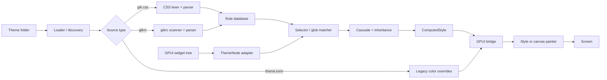

# GTK Theme Engine — Initial Architecture

Status: Proposed  
Date: 2026-11-22  
Working branch: `docs/gtk-theme-engine-plan` (derived from `feat/freedesktop-icon-themes`)  
Target repository path: `docs/design/gtk-theme-engine/architecture.md` (write after plan mode is closed)  
Related issues: #92, #93, #94, #199, #45, #120/#122, #168

## 1. Purpose

This document fixes the initial architecture for a full GTK visual theme engine in
RustyFiles. The engine reads real GTK theme folders (`gtk-2.0/gtkrc`,
`gtk-3.0/gtk.css`, `gtk-4.0/gtk.css`), resolves their rules, and paints the result
on the widget tree that RustyFiles already draws with GPUI.

Icon theming is explicitly out of scope. Icons stay in the separate icon-theme
work (Freedesktop `index.theme` packs and the existing theme-folder `icons\`
directory). A GTK theme folder may contain an `icons\` directory, but this engine
must not read it.

"Full support" means: support the GTK theme languages, their cascade, their
states, and their visual effects on the nodes RustyFiles renders. It does not
mean loading GTK's C theme engines or reproducing GTK's GSK node tree pixel for
pixel. RustyFiles is not a GTK app; the theme is applied to an intentionally
designed RustyFiles node tree.

## 2. Verified starting point

### 2.1 Project state

- `crates/rf-app/src/theme.rs:8-42` defines `Palette` with 21 `Hsla` slots plus
  `dark` and `liquid` flags.
- `Palette::for_window` (`theme.rs:162-212`) composes base palette, Explorer
  look, solid backdrop, theme-folder colors, and glass washes.
- `crates/rf-app/src/themes.rs:23-38` defines the 21 `COLOR_KEYS` and the
  `theme.toml` format. `themes.rs:175-190` resolves folder/file icons.
- `docs/themes.md:18-60` documents the current color + icon theme folder.
- Settings already has `ThemePref {System, Light, Dark, Black}` and a
  `Theme folder` picker.
- GPUI is `gpui-kit 0.9.0` re-exporting `gpui-pre 0.3.11`. It provides
  `Styled` helpers, `div()`, `h_flex()`, `v_flex()`, `bg()`, borders, corner
  radii, box shadows, linear gradients, `canvas()`, `img()`, `svg()`, and low
  level `Window::paint_*` hooks.
- There is no CSS stylesheet parser in the lockfile. `simplecss 0.2.2` is only
  used by `usvg` for SVG presentation attributes.
- `gpui-component` has an unused `ActiveTheme`/`ThemeSet` model. RustyFiles
  does not use it; do not build on it.
- The dock has its own palette in `crates/rf-app/src/dock/look.rs`. It needs its
  own adapter in the surface sweep.

### 2.2 Issue survey

- #92 "App Theming" is closed; maintainer said colors and icons first, full
  visual styles later.
- #93 is the open umbrella issue for a full theme/visual-style engine and is
  the natural home for this work.
- #94 covers icon packs and is being handled by PR #182. This engine must not
  absorb it.
- #199 asks for deeper dock theming; only part is implemented. The engine must
  expose dock nodes so #199 can be addressed later.
- #45 asked for pure black, fonts, and icon themes. Pure black and font choice
  are already in. Fonts remain independent of this engine.
- #120/#122 added the optional Windows File Explorer look. It is a hard-coded
  look, not a theme language. Keep it working with the engine off.
- #168 (tab shape) is resolved on main, but tab geometry is a known sensitive
  surface. Include tabs in the visual regression checklist.

No existing branch or source file implements a CSS engine, `gtkrc` parser, or
GTK node adapter. The only related work is theme folders, icon themes, and the
Explorer look.

### 2.3 Sample themes inspected

The user supplied `H:\Downloads\themes\gtk`. These are research fixtures only;
do not commit them into the repository.

| Theme | Facts that shape the parser |
|---|---|
| Agata | `gtk.css` 8226 lines, 91 `@define-color`, 29 `url()`, 48 gradients, 227 `box-shadow`, 25 `border-image`, `@keyframes`, GTK3 and GTK4 folders, `gtk-dark.css` |
| Grass | `gtk.css` 3608 lines, 35 `@define-color`, 48 gradients, 96 `box-shadow`, many literal colors |
| Human | `@import url("...")` chaining, `shade()`, `alpha()`, `mix()`, `engine "murrine"` with numeric parameters, GTK2/3/4 folders |
| se98 | many per-widget `.rc` files and PNG asset folders for GTK2-style rendering |
| orthogonal2 | generated color schemes; useful parser stress, not a primary target |

Consequences: the parser must handle variables, local imports, color functions,
gradients, shadows, image assets, nine-slice borders, keyframes, and GTK2
engine blocks. A color-only importer would not be enough.

## 3. Goals

1. Load unmodified GTK2, GTK3, and GTK4 theme folders from the existing
   `themes\` directory.
2. Parse the compiled theme languages well enough to drive real community
   themes, not just hand-written fixtures.
3. Build a deterministic RustyFiles node tree with GTK-compatible names,
   classes, and state flags.
4. Resolve CSS/GTK rules with specificity, inheritance, state matching, and
   source order.
5. Paint backgrounds, borders, radii, gradients, images, shadows, opacity, and
   text styles using GPUI.
6. Keep the engine off by default. With it off, rendering must follow the exact
   current code path.
7. Keep icons isolated. No icon resolution in this engine.
8. Make every phase testable without starting the app, plus a manual visual
   matrix before each release gate.

## 4. Non-goals

- Loading GTK C engines (`murrine`, `clearlooks`, `adwaita`) via `dlopen`.
- Full GSK render-node parity or pixel-perfect GTK screenshots.
- Rendering GTK widget parts that RustyFiles does not have.
- File/folder/drive icon resolution.
- OS visual-style patching (`uxtheme`, `.msstyles` hooking).
- SCSS compilation. Only compiled `gtk.css` files are supported.

## 5. Pipeline



The engine is a pure data pipeline until the GPUI bridge. Only the last two
boxes depend on GPUI.

## 6. Module layout

```text
crates/rf-theme-engine/          # pure Rust, no GPUI dependency
  src/lib.rs                     # public API: ThemeEngine, resolve(), EngineTheme
  src/model.rs                   # Color, Length, Paint, Shadow, Radius, Edges
  src/style.rs                   # ComputedStyle + property registry
  src/css/
    lexer.rs                     # tokens, comments, strings, functions
    parser.rs                    # rulesets, at-rules, declarations, values
    selector.rs                  # selector AST, specificity, matcher
    value.rs                     # color functions, gradients, images, lengths
    cascade.rs                   # source order, inheritance, !important
  src/gtkrc/
    scanner.rs                   # gtkrc token stream
    parser.rs                    # style/widget/class/include/engine blocks
    matcher.rs                   # path globs, class paths, priorities
  src/asset.rs                   # safe local asset loading + caps
  src/theme.rs                   # folder discovery, variant lookup, cache

crates/rf-app/src/
  theme_engine.rs                # settings bridge, Palette composition
  theme_nodes.rs                 # GPUI element -> ThemeNode adapter
  theme_paint.rs                 # Style/canvas painting helpers

docs/design/gtk-theme-engine/
  architecture.md                # this file
  plan.md                        # phases, tasks, investigations, checkpoints
```

## 7. Core model

Target shape, not final API:

```rust
pub struct ThemeNode {
    pub name: String,             // "button", "row", "entry", "window"
    pub classes: Vec<String>,     // "sidebar", "flat", "suggested-action"
    pub states: StateFlags,       // HOVER | ACTIVE | SELECTED | FOCUS | ...
    pub children: Vec<ThemeNode>,
}

pub struct ComputedStyle {
    pub color: Color,
    pub background: Vec<Paint>,
    pub border: Edges<Border>,
    pub radius: Corners<Length>,
    pub shadow: Vec<Shadow>,
    pub text_shadow: Vec<Shadow>,
    pub font: FontSpec,
    pub padding: Edges<Length>,
    pub margin: Edges<Length>,
    pub opacity: f32,
}

pub enum Paint {
    Color(Color),
    LinearGradient(LinearGradient),
    RadialGradient(RadialGradient),
    ConicGradient(ConicGradient),
    Image(AssetId),
    BorderImage { asset: AssetId, slice: Edges<Length>, repeat: Repeat },
}
```

`StateFlags` mirrors GTK's state pseudo-classes: `:hover`, `:active`,
`:selected`, `:disabled`, `:indeterminate`, `:focus`, `:backdrop`, `:checked`,
`:focus-visible`, `:focus-within`. Focus propagation follows GTK semantics,
not web CSS.

## 8. Style resolution

### 8.1 Precedence

Highest to lowest:

1. `theme.toml` color overrides (legacy compatibility).
2. Explicit GTK rule with higher specificity / later source order / `!important`.
3. GTK rule with lower specificity.
4. Built-in RustyFiles `Palette`.

The engine builds its fallback from `Palette::for_window`, which already
includes theme pref, Explorer look, solid backdrop, and glass decisions. When
GTK rules replace a surface, glass/Mica still draws underneath; the engine does
not remove the OS material.

### 8.2 Variants

Discover in this order, matching GTK behavior:

1. `gtk-4.0/gtk.css`, `gtk-4.0/gtk-dark.css`
2. `gtk-3.0/gtk.css`, `gtk-3.0/gtk-dark.css`
3. `gtk-2.0/gtkrc`, `gtk-2.0/gtkrc-dark`

A setting chooses `Auto`, `GTK4`, `GTK3`, or `GTK2`. Auto prefers the highest
available version. Dark variant follows `ThemePref::Dark` / `Black`, or
Windows appearance under `ThemePref::System`.

### 8.3 CSS features

Required: selectors, combinators, `:not()`, structural pseudo-classes, state
pseudo-classes, `@define-color`, `:root` custom properties, `var()`, local
`@import`, `@keyframes` parsing, color functions, gradients, `url()`, image,
border-image, box-shadow, text-shadow, font, padding, margin, opacity,
`inherit/initial/unset`, specificity, and `!important`.

Animations are parsed and ignored in M1-M6. Adding interpolation is a separate
task in M7, after static rendering is correct.

### 8.4 GTK2 features

Required: `style`, `widget`, `widget_class`, `class`, `include`, `pixmap_path`,
`engine`, color arrays for all five states, `bg_pixmap`, `xthickness`,
`ythickness`, `GtkWidget::*` properties, style inheritance, path/class globs,
and GTK priorities. Engine blocks are parsed and stored. Common visual effects
from `murrine`, `clearlooks`, and pixmap engines get Rust equivalents in the
painter; unknown engines degrade to the nearest generic style and log.

## 9. GPUI integration

- `theme_nodes.rs` produces a `ThemeNode` for each themed container. State comes
  from GPUI's existing interaction methods (`hover`, `active`, focus,
  selection, disabled, backdrop) and from app state flags.
- `theme_paint.rs` maps `ComputedStyle` to existing GPUI `Style` fields where
  possible: `bg`, `border`, `corner_radii`, `box_shadow`, `text_color`,
  `font_size`, `opacity`, padding, margin.
- Anything GPUI cannot express directly is drawn with `canvas()` and the
  `Window::paint_*` hooks: radial/conic gradients, layered backgrounds,
  nine-slice images, per-side borders, inset shadows, blur.
- `themed()` is the single helper that attaches a node and applies its style.
  It wraps the current `div()`/`h_flex()`/`v_flex()` builders; it does not
  replace them.
- The dock gets a separate adapter because it owns a separate palette.

## 10. Security and robustness

- `@import` and `url()` resolve only inside the selected theme folder.
- Reject absolute paths, `..`, UNC/network paths, non-`file` schemes, and
  symlinks that escape the folder.
- Cap each text/asset read at 4 MiB and total decoded images at 64 MiB.
- SVG uses the existing `resvg`/`usvg` path with file-based `<image href>`
  already refused by the icon-theme work.
- No arbitrary code execution. No C engine loading.
- Parse errors skip the offending rule and log `theme`, `file`, and `line`.
- Unknown properties, selectors, and engines are logged once per theme load.
- Engine off = no parsing, no asset loads, no node overhead.

## 11. Decisions

### D1 — New crate instead of extending `rf-app`

`rf-theme-engine` stays pure Rust and unit-testable. `rf-app` only bridges and
paints. Rejected: putting parser code inside `rf-app`, where it would be coupled
to GPUI and harder to test.

### D2 — Own CSS parser instead of a dependency

`simplecss` only handles SVG presentation attributes. No lockfile crate gives a
GTK CSS cascade. Rejected: adding a generic web CSS crate and adapting it to
GTK pseudo-classes, which would carry unused browser semantics.

### D3 — Rust reimplementation instead of C engine ABI

GTK engines are C shared objects with ABI-specific drawing calls. Loading them
would be unsafe and non-portable. Rejected: `dlopen`; chosen: interpret common
engine parameters and draw equivalent effects with our painter.

### D4 — GTK3 CSS first

GTK3 CSS is the largest catalog in the sample set and closest to RustyFiles'
layout. GTK2 `gtkrc` and GTK4 differences follow once the model and cascade are
stable. Rejected: starting with GTK2, which has a separate grammar and engine
model and would not exercise the CSS pipeline.

### D5 — Feature flag, default off

The engine changes many surfaces. Default off preserves current users and makes
regressions easy to isolate. Rejected: enabling by default in the first release.

## 12. Risks

| Risk | Impact | Mitigation |
|---|---|---|
| CSS grammar larger than expected | High | Sample-driven parser tests from Agata, Grass, Human, se98 before broad UI work |
| GPUI cannot express some effects | Medium | `canvas()` / `paint_*` fallback defined in M4, not discovered late |
| Node mapping drifts from real themes | High | Publish node/class table in this doc set and test each mapped node against a fixture theme |
| Performance on large theme folders | Medium | Parse once, cache computed styles, cap reads, no work when engine off |
| Legacy Explorer look breaks | High | Engine off path unchanged; Explorer look in manual matrix every phase |
| Dock uses a separate palette | Medium | Separate adapter and checklist item in M5 |
| License contamination from sample themes | Medium | Never commit downloaded themes; only small hand-made fixtures |

## 13. Open questions and provisional answers

1. Public theme format vs internal compatibility layer?  
   Provisional: internal compatibility layer for GTK folders; no new public
   format in this work.
2. Dark variant under `ThemePref::System`?  
   Provisional: follow Windows appearance, same as current palette.
3. First GTK2 engine effects to implement?  
   Provisional: `murrine` gradients/glazestyle, then `clearlooks` bevels, then
   pixmap frames.
4. Animation support in first beta?  
   Provisional: parse and ignore; document as unsupported until M7.

Changing a provisional answer requires updating both documents.

## 14. Node/class table (M0.1)

This is the mapping the engine targets. `rf-*` classes are RustyFiles-specific
extensions; GTK themes can still match the generic GTK name in column two.
State flags come from GPUI interaction methods and app state, not from DOM focus.

| RustyFiles surface | Node name | Classes | State flags |
|---|---|---|---|
| Main window root | `window` | `background`, `rf-window`, `main` | `ACTIVE`, `BACKDROP` |
| Titlebar | `headerbar` | `titlebar`, `rf-titlebar` | `ACTIVE`, `BACKDROP` |
| Tab strip | `notebook > header` | `tabs`, `rf-tabstrip` | `ACTIVE` |
| Tab | `notebook > tab` | `tab`, `rf-tab` | `ACTIVE`, `SELECTED`, `HOVER`, `FOCUS_VISIBLE` |
| Tab action / plus button | `button` | `flat`, `tab-action` | `HOVER`, `ACTIVE` |
| Command bar | `toolbar` | `command-bar`, `primary-toolbar` | `BACKDROP` |
| Toolbar button | `button` | `flat`, `toolbar-button`, `suggested-action` | `HOVER`, `ACTIVE`, `CHECKED`, `DISABLED` |
| Address bar | `entry` | `addressbar`, `path-entry` | `FOCUS`, `ACTIVE` |
| Breadcrumb button | `button` | `flat`, `breadcrumb` | `HOVER`, `ACTIVE` |
| Sidebar container | `placessidebar` | `sidebar`, `rf-sidebar` | `BACKDROP` |
| Sidebar section label | `label` | `sidebar-section`, `dim-label` | none |
| Sidebar row | `row` | `sidebar-row`, `pinned`, `drive` | `HOVER`, `SELECTED`, `ACTIVE`, `DISABLED` |
| Folder-tree row | `treeview.view row` | `tree-row`, `folder`, `expanded` | `HOVER`, `SELECTED`, `ACTIVE` |
| File-list viewport | `treeview.view` | `view`, `file-list`, `grid`, `details` | `BACKDROP` |
| File row / cell | `row` | `file-row`, `file`, `folder`, `cut` | `HOVER`, `SELECTED`, `ACTIVE`, `FOCUS`, `DISABLED` |
| Grid tile | `flowboxchild` | `tile`, `file-tile` | `HOVER`, `SELECTED`, `ACTIVE`, `FOCUS` |
| Cards item | `row` | `card`, `file-card` | `HOVER`, `SELECTED`, `ACTIVE`, `FOCUS` |
| Home tile | `button` | `home-tile`, `card` | `HOVER`, `ACTIVE` |
| Preview pane | `paned` | `preview-pane`, `rf-preview` | `BACKDROP` |
| Status bar | `statusbar` | `status-bar` | `BACKDROP` |
| Menu / flyout | `menu` | `menu`, `popup`, `rf-menu` | `BACKDROP` |
| Menu item | `menuitem` | `menuitem`, `check`, `radio` | `HOVER`, `ACTIVE`, `CHECKED`, `DISABLED` |
| Context menu | `menu` | `context-menu`, `popup` | `BACKDROP` |
| Dialog surface | `dialog` | `dialog`, `rf-dialog` | `ACTIVE`, `BACKDROP` |
| Text input | `entry` | `entry`, `text-input` | `FOCUS`, `ACTIVE`, `DISABLED` |
| Check / radio / switch | `checkbutton` / `radiobutton` / `switch` | `check`, `radio`, `switch` | `CHECKED`, `HOVER`, `ACTIVE`, `DISABLED` |
| Scrollbar | `scrollbar` | `scrollbar`, `vertical`, `horizontal` | `HOVER`, `ACTIVE` |
| Tooltip | `tooltip` | `tooltip`, `window` | `BACKDROP` |
| Progress bar / spinner | `progressbar` | `progress`, `spinner` | `ACTIVE`, `INDETERMINATE` |
| Dock panel | `window` | `dock`, `rf-dock`, `glass`, `solid` | `ACTIVE`, `BACKDROP` |
| Dock item | `button` | `dock-item`, `running`, `pinned` | `HOVER`, `ACTIVE`, `SELECTED` |
| Dock preview card | `window` | `dock-preview`, `popup` | `BACKDROP` |
| Recycle Bin row | `row` | `sidebar-row`, `recycle-bin`, `empty`, `full` | `HOVER`, `SELECTED` |
| Toast / notification | `window` | `toast`, `popup` | `BACKDROP` |
| Settings controls | reuse `dialog`, `row`, `button`, `entry`, `switch`, `checkbutton`, `label` | same as above | same as above |

Reviewed against the extracted Agata, Grass, and Human archives. Confirmed GTK
node names: `button`, `entry`, `treeview.view row`, `menuitem`, `notebook tab`,
`scrollbar`, `tooltip`, `progressbar`, `toolbar`, `headerbar`. Unmatched by
those themes: `placessidebar`, `dock`, `home-tile`, and the `rf-*` classes; they
use the nearest GTK node plus a RustyFiles-specific class.

## 15. Property registry (M0.2)

The full classification is in `property-registry.md` in this directory. It was
generated from the compiled CSS of Agata, Grass, and Human: 312 distinct
properties, 78 marked `supported`, 77 `parse-only`, and 157 `ignored`. The
archives stay outside the repository.
