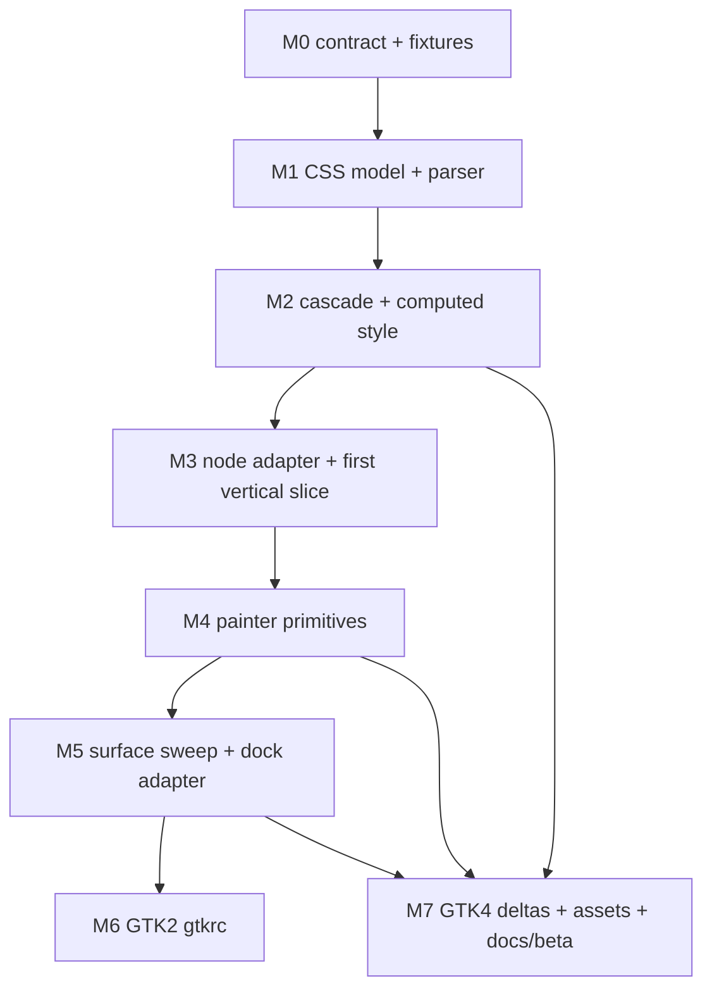

# GTK Theme Engine — Implementation Plan

Status: Proposed  
Date: 2026-11-22  
Working branch: `docs/gtk-theme-engine-plan` (derived from `feat/freedesktop-icon-themes`)  
Target repository path: `docs/design/gtk-theme-engine/plan.md` (write after plan mode is closed)  
Read first: `gtk-theme-engine-architecture.md`

## 0. How to use this plan

Each milestone has four parts:

1. **Investigate first** — questions to answer with evidence before editing.
2. **Work items** — small tasks with files, acceptance, and verification.
3. **Checkpoint** — tests and a manual gate.
4. **Gate** — explicit human `sim` / `segue` before the next milestone.

No task starts before its investigation is written down in the milestone section.
When an investigation contradicts the architecture, update both documents before
writing code.

## A. Research already done

- Repository issues: #92 (closed, colors/icons first), #93 (open umbrella for
  full visual styles), #94 (icon packs, PR #182), #199 (dock theming), #45
  (black theme + fonts + icons; black and fonts already shipped), #120/#122
  (hard-coded Explorer look), #168 (tab shape, resolved on main).
- No existing CSS engine, `gtkrc` parser, or GTK node adapter in `crates/`.
- `Palette` is 21 colors in `crates/rf-app/src/theme.rs`; `theme.toml` uses
  those 21 keys in `crates/rf-app/src/themes.rs`.
- GPUI path: `gpui-kit 0.9.0` / `gpui-pre 0.3.11`; `Styled`, `div`, `h_flex`,
  `v_flex`, `bg`, borders, radii, shadows, gradients, `canvas`, `img`, `svg`,
  and `Window::paint_*` are available.
- `simplecss` is only an SVG presentation-attribute parser via `usvg`.
- `gpui-component` `ActiveTheme`/`ThemeSet` exists but is unused; do not reuse.
- The user's local corpus `H:\Downloads\themes\gtk` contains Agata, Grass,
  Human, se98, and orthogonal2. Agata alone has 91 `@define-color`, 29 `url()`,
  48 gradients, 227 `box-shadow`, 25 `border-image`, and a separate
  `gtk-dark.css`. Human uses imported CSS, color functions, and GTK2 engine
  parameters. This corpus is for research only; never commit it.

## B. Dependency graph



M0 and M1 are pure Rust. M2 stays pure Rust. M3 is the first app integration.
M4 unlocks visual correctness. M5 is the largest sweep. M6 and M7 can be split
between agents after M2 is frozen, because they touch separate parser modules.

## C. Milestones

---

### M0 — Freeze the contract and build fixtures

**Goal.** Decide exactly what "full GTK theme support" means in RustyFiles and
create tiny, license-clean fixtures that every later milestone can test against.

**Investigate first**

- Read #93, #92, #94, #199, #45, #120/#122 end to end. Record which promises
  this work makes and which stay out.
- List all widgets RustyFiles actually draws: window, titlebar, tab strip, tab,
  toolbar/command bar, address bar, sidebar/tree rows, file rows in Grid/List/
  Cards/Details, preview pane, status bar, menus/flyouts, dialogs/inputs, Home
  tiles, dock panels, dock items, recycle bin, notification/toast.
- Map each widget to its current GPUI builder and state source. `theme.rs`,
  `workspace.rs`, `folder_view.rs`, `sidebar_tree.rs`, `settings_view.rs`,
  `fluent_menu.rs`, `flyout.rs`, `dock/look.rs`, and `glass.rs` are the starting
  files.
- Verify which node names and classes real themes expect. Grep the local corpus
  for `button`, `entry`, `treeview`, `menuitem`, `notebook`, `scrollbar`,
  `tooltip`, `progressbar`, `.sidebar`, `.view`, `.flat`, `.suggested-action`.
- Confirm licensing of every sample theme. Do not copy any sample into the repo.
  Hand-write fixtures instead.

**Work items**

| ID | Task | Files | Acceptance | Verification |
|---|---|---|---|---|
| M0.1 | Write node/class table | architecture doc | Every RustyFiles surface has one node name + classes + state flags | Table reviewed against at least 3 sample themes |
| M0.2 | Write property registry | architecture doc + `property-registry.md` + `rf-theme-engine/src/style.rs` stub | Every property seen in Agata/Grass/Human is `supported`, `parse-only`, or `ignored` with reason | Grep sample corpus; count matches |
| M0.3 | Create hand-made fixtures | `crates/rf-theme-engine/tests/fixtures/` | 3 tiny themes: CSS colors, CSS gradients/shadows/images, gtkrc styles; no third-party files | `cargo test -p rf-theme-engine --lib` |
| M0.4 | Copy the docs into repo | `docs/design/gtk-theme-engine/{architecture,plan,property-registry}.md` | Docs present on the branch, no sample themes committed | `git status --short` clean after commit |
| M0.5 | Settings contract | `crates/rf-app/src/settings.rs` | `ThemeEnginePref {Off, Auto, GTK4, GTK3, GTK2}` exists, default `Off`, serialized compatibly | Existing settings round-trip test |

**Checkpoint**

- `cargo test -p rf-app --lib`
- `cargo build --profile fast -p rf-app`
- `python scripts/i18n_source.py --check`
- Manual: engine off looks identical to current `feat/freedesktop-icon-themes`.

**Gate.** Human reviews node table + property registry before M1.

**Exit criteria.** Contract written; fixtures committed; no third-party theme
assets in git; setting exists and defaults off.

---

### M1 — CSS lexer and parser (GTK3 baseline)

**Goal.** Turn `gtk.css` text into a typed rule database, without GPUI.

**Investigate first**

- Tokenize the three largest `gtk.css` files from Agata, Grass, Human. Record
  every token type that appears: comments, strings, URLs, numbers, dimensions,
  functions, hex colors, `!important`, at-rules, braces, selectors.
- Decide how to handle `@import url(...)` with relative paths, nested
  directories, and missing files.
- Decide how to handle `@keyframes`: parse into an inert AST now, interpolate
  later.
- Decide error recovery: skip declaration vs skip rule vs skip file. Log
  `file:line`, one message per unique problem.

**Work items**

| ID | Task | Files | Acceptance | Verification |
|---|---|---|---|---|
| M1.1 | Tokenizer | `src/css/lexer.rs` | Handles comments, strings, escapes, functions, numbers, dimensions, hex, `!important`; unit tests | `cargo test -p rf-theme-engine --lib css::lexer` |
| M1.2 | Declaration/value parser | `src/css/parser.rs`, `src/css/value.rs` | Parses colors (`#RGB`, `#RRGGBB`, `#RRGGBBAA`, named), `rgba()`, `shade()`, `alpha()`, `mix()`, gradients, `url()`, lengths | Unit tests from M0.3 fixtures |
| M1.3 | Ruleset parser | `src/css/parser.rs` | Parses selectors, combinators, pseudo-classes, `:root`, `@define-color`, `@import`, `@keyframes` | Fixture + real-theme parse test |
| M1.4 | Parse real corpus | `tests/parse_real_themes.rs` | Agata, Grass, Human parse without panic; report unknown declarations | Test runs from local path, skipped if corpus absent |
| M1.5 | Error policy | `src/css/parser.rs` | Invalid rule does not drop later rules; log carries `file:line` | Corrupt a fixture copy and assert recovery |

**Checkpoint**

- `cargo test -p rf-theme-engine --lib`
- `cargo clippy -p rf-theme-engine --all-targets -- -D warnings`
- Report: count of parsed rules and unknown properties per sample theme.

**Gate.** Human reviews parse coverage and unknown-property list.

**Exit criteria.** Real GTK3 CSS parses. No app behavior changed yet.

**M1 executado (2026-11-22).** Adicionados `src/css/lexer.rs`,
`src/css/value.rs`, `src/css/selector.rs`, `src/css/parser.rs` e o teste de
corpus `tests/parse_real_themes.rs`. O corpus real foi extraído de
`H:\Downloads\themes\gtk` para um diretório temporário; 17 arquivos parsearam
sem pânico (1892 regras, 16 imports/keyframes, 40 propriedades desconhecidas
únicas). Detalhes em `m1-parse-report.md`. Testes e clippy passaram. Nenhuma
mudança de comportamento no app: engine continua `off`, sem ponte GPUI.

---

### M2 — Cascade, selectors, and computed style

**Goal.** Given a node and a rule database, return one `ComputedStyle`.

**Investigate first**

- Document GTK selector specificity vs CSS specificity. Test with real themes
  using `.button:active`, `window.background`, `GtkTreeView row`, `:not()`.
- Determine inheritance rules for `color`, `font`, `-gtk-icon-style`, and
  `background-color`. Decide which properties inherit by default.
- Decide state propagation: `:focus-within` on ancestors, `:backdrop` on the
  active window only, `:selected` coming from app state not GPUI hover.
- Decide how `theme.toml` overrides interact with GTK rules. Architecture
  answer: `theme.toml` wins as final color override; verify with a fixture.

**Work items**

| ID | Task | Files | Acceptance | Verification |
|---|---|---|---|---|
| M2.1 | Selector AST + matcher | `src/css/selector.rs` | Matches name, class, id, descendant/child/sibling, pseudo-classes, `:not()`; specificity computed | Unit tests for each case |
| M2.2 | Cascade | `src/css/cascade.rs` | Source order + specificity + `!important` + inheritance resolved deterministically | Golden computed-style tests |
| M2.3 | ComputedStyle builder | `src/style.rs` | Produces full style from base `Palette`-like colors; no GPUI types | Property-by-property tests |
| M2.4 | Dark variant lookup | `src/theme.rs` | Chooses `gtk.css` vs `gtk-dark.css` from pref/appearance | Unit tests for all `ThemePref` values |
| M2.5 | `theme.toml` precedence | `src/theme.rs` | Legacy 21 color keys override computed colors | Fixture test |

**Checkpoint**

- `cargo test -p rf-theme-engine --lib`
- Determinism test: same input + same node = identical `ComputedStyle`.
- No app integration yet.

**Gate.** Human reviews cascade semantics against one real theme.

**Exit criteria.** `resolve(node, theme) -> ComputedStyle` stable and tested.

**Status — done 2026-11-22.** Added `css/cascade.rs`, `theme.rs`,
`ThemeNode`/`StateFlags`/`ComputedStyle`/`LegacyPalette`. A review found and
fixed three defects before completion: winner application ignored declaration
order, whitespace shorthands stayed `Raw`, and `:not()` kept only its first
argument. 21 library tests, 11 cascade tests and 2 real-corpus integration
tests now pass. Details in `m2-cascade-report.md`. No GPUI code changed; the
engine remains off.

---

### M3 — Node adapter and first vertical slice

**Goal.** Prove the engine can style a real RustyFiles window before doing a
full surface sweep.

**Investigate first**

- Inspect `Palette::for_window` call sites and where `cx`/`window` are
  available. Decide where a `ThemeEngine` handle lives: global `Arc<RwLock<_>>`
  like `themes::CURRENT`, or `World`/`App` state.
- Inspect GPUI `Interaction` methods used today. Map hover, active, focus,
  selected, disabled, and backdrop to `StateFlags`.
- Pick a small vertical slice: titlebar + tab strip + one sidebar row + one
  file row. Avoid menus and dialogs in this milestone.
- Decide invalidation: settings change, theme folder change, appearance change,
  state change. State changes must not reparse the theme.

**Work items**

| ID | Task | Files | Acceptance | Verification |
|---|---|---|---|---|
| M3.1 | Engine handle + settings bridge | `rf-app/src/theme_engine.rs` | Loads theme when setting changes; off = no load | Unit test for off/on |
| M3.2 | Node adapter | `rf-app/src/theme_nodes.rs` | Builds `ThemeNode` for the 4 slice surfaces with correct state | Unit tests from synthetic nodes |
| M3.3 | `themed()` wrapper | `rf-app/src/theme_nodes.rs` | Wraps existing builders; off returns unchanged element | Diff review; off path unchanged |
| M3.4 | Slice integration | `workspace.rs`, `sidebar_tree.rs`, `folder_view.rs` | Slice surfaces change with theme on, unchanged with off | Manual visual check |
| M3.5 | Invalidation | `theme_engine.rs`, `settings.rs` | Reparse only on theme/settings change; state change only recomputes node style | Log-count test |

**Checkpoint**

- `cargo test -p rf-app --lib`
- `cargo build --profile fast -p rf-app`
- Manual: off = baseline; on = fixture theme changes the 4 surfaces.

**Gate.** Human reviews the slice visually before M4.

**Exit criteria.** One real vertical slice works end to end; no broad sweep yet.

**Status — implemented 2026-11-22, visual gate pending.** Added
`theme_engine.rs`, `theme_nodes.rs`, a GTK theme engine selector in Appearance,
and the four-surface slice. The M3 fixture also exposed an M2 descendant-selector
parser bug, now fixed and covered by a regression test. Details and manual
check steps are in `m3-slice-report.md`. Engine default remains `off`.

---

### M4 — Painter primitives

**Goal.** Paint every style property the parser can produce.

**Investigate first**

- For each `Paint` variant, decide `Style` field vs `canvas()` vs
  `Window::paint_*`. Record the reason in a table in the architecture doc.
- Verify GPUI supports per-corner radii, per-side borders, inset shadows,
  radial/conic gradients, and nine-slice images. Where it does not, define the
  custom draw call now.
- Measure DPR handling with a scaled window. All lengths must be CSS px.

**Work items**

| ID | Task | Files | Acceptance | Verification |
|---|---|---|---|---|
| M4.1 | Style-field mapping | `theme_paint.rs` | color, bg color, border, radius, shadow, font, padding, margin, opacity mapped | Unit tests where possible |
| M4.2 | Gradient painter | `theme_paint.rs` | linear/radial/conic render with correct stops and DPR | Manual fixture screenshots |
| M4.3 | Image + nine-slice | `theme_paint.rs`, `asset.rs` | local PNG/SVG loads inside theme folder; border-image slices correctly | Asset escape tests |
| M4.4 | Shadow/glass interaction | `theme_paint.rs` | box-shadow and inset shadow do not break glass/Mica underneath | Manual check with Mica, Solid, HyperGlass |
| M4.5 | Parse-only effect fallback | `theme_paint.rs` | Animations and unknown effects degrade to static style + log | Fixture test |

**Checkpoint**

- `cargo test -p rf-app --lib`
- `cargo build --profile fast -p rf-app`
- Manual matrix: Agata, Grass, Human fixture variants on the M3 slice.

**Gate.** Human reviews painter coverage table.

**Exit criteria.** No parsed property silently draws nothing.

---

### M5 — Surface sweep

**Goal.** Apply the engine to every RustyFiles surface, including the dock.

**Investigate first**

- Build the full surface checklist from M0, one row per surface.
- For each surface, list its node name, classes, state source, and current
  fallback. Mark `hard` surfaces: menus/flyouts, dialogs, liquid glass tabs,
  Home tiles, dock, context menus, RTL rows.
- Check Explorer-look interactions: theme off must keep current behavior;
  theme on should not overwrite Explorer-specific icon choices.
- Check high-contrast mode and accessibility: engine must never remove focus
  indicators or reduce text contrast below the current baseline.

**Work items**

| ID | Task | Files | Acceptance | Verification |
|---|---|---|---|---|
| M5.1 | Chrome surfaces | `workspace.rs`, `folder_view.rs`, `address_bar.rs`, `status_bar.rs` | Toolbar, address, tab strip, status bar themed | Manual, both pref modes |
| M5.2 | Content surfaces | `folder_view.rs`, `home.rs`, `preview_pane.rs` | Grid/List/Cards/Details rows and Home tiles themed | Manual with real files |
| M5.3 | Sidebar + tree | `sidebar_tree.rs`, `places.rs` | Tree rows, pinned sections, drives themed | Manual with nested folders and drives |
| M5.4 | Menus + dialogs | `fluent_menu.rs`, `flyout.rs`, `ctx_menu.rs`, dialog views | Menus, flyouts, inputs, buttons themed | Manual multi-screen flow |
| M5.5 | Dock adapter | `dock/look.rs`, `dock/*` | Dock panels and items themed without affecting window palette | Manual on desktop |
| M5.6 | Regression sweep | docs checklist | Every surface marked pass/fail with theme off and on | Human signs checklist |

**Checkpoint**

- `cargo test -p rf-app --lib`
- `cargo test -p rf-win --lib folder_custom`
- `cargo test -p rf-win --lib thumbs`
- `cargo build --profile fast -p rf-app`
- `python scripts/i18n_source.py --check`
- Manual: theme off baseline + theme on sample fixtures on all surfaces.

**Gate.** Human reviews full checklist before M6.

**Exit criteria.** No themed surface left on the base palette unless
intentionally excluded and documented.

---

### M6 — GTK2 `gtkrc` support

**Goal.** Load `gtk-2.0/gtkrc` folders, including common engine parameters.

**Investigate first**

- Read Human, se98, and Agata GTK2 files. List all `style`, `widget`,
  `widget_class`, `class`, `include`, `pixmap_path`, `engine`, state color,
  `bg_pixmap`, `xthickness`, `ythickness`, and priority forms used.
- Map GTK2 widget paths to the M0 node table. Record unmatched paths.
- Decide glob semantics (`*`, `GtkWidget*`, `.class`, `parent.child`).
- Decide which `engine "murrine"` / `"clearlooks"` parameters have Rust
  equivalents; list all parameters that will be ignored.
- Verify file inclusion is inside the theme folder and capped at 4 MiB.

**Work items**

| ID | Task | Files | Acceptance | Verification |
|---|---|---|---|---|
| M6.1 | gtkrc scanner/parser | `src/gtkrc/scanner.rs`, `parser.rs` | All forms from investigation parse into styles | Unit tests from hand-made gtkrc fixture |
| M6.2 | Glob matcher + priority | `src/gtkrc/matcher.rs` | GTK2 path/glob/priority resolution matches sample expectations | Golden tests |
| M6.3 | Convert to ComputedStyle | `src/gtkrc/mod.rs`, `src/style.rs` | gtkrc style becomes same `ComputedStyle` as CSS | Cross-format fixture test |
| M6.4 | Engine effect shims | `rf-app/src/theme_paint.rs` | murrine gradient/glazestyle, clearlooks bevel, pixmap frames render | Manual fixture check |
| M6.5 | Settings wiring | `settings.rs`, `theme_engine.rs` | `GTK2` mode loads `gtkrc` and `gtkrc-dark` | Unit + manual test |

**Checkpoint**

- Same commands as M5.
- Manual: Human and se98 fixtures on at least the M3 slice + full sweep.

**Gate.** Human reviews GTK2 coverage and ignored-parameter list.

**Exit criteria.** GTK2 folders load without C engines and render reasonable
results on all mapped nodes.

---

### M7 — GTK4 deltas, polish, docs, and beta

**Goal.** Cover GTK4-specific syntax, finish assets, and make the feature
reviewable.

**Investigate first**

- Diff Agata GTK3 and GTK4 CSS. List differences in selectors, `@define-color`,
  `color-mix()`, `gtk.gresource`, libadwaita nodes, and `gtk-dark.css`.
- Decide whether animation support is required for beta. Provisional answer:
  parse-only until a later milestone.
- Measure theme load time and frame cost with the largest sample theme. Set a
  budget and log when it is exceeded.
- Review final diff against upstream; keep fork-local files out of the branch.

**Work items**

| ID | Task | Files | Acceptance | Verification |
|---|---|---|---|---|
| M7.1 | GTK4 deltas | `src/css/*`, `src/theme.rs` | Agata GTK4 parses; differences documented | Corpus test + docs |
| M7.2 | Asset safety pass | `src/asset.rs` | 4 MiB file cap, 64 MiB total, path escape tests | Security unit tests |
| M7.3 | Performance cache | `src/theme.rs`, `theme_engine.rs` | Parsed/computed styles cached; no work when off | Timing test + log check |
| M7.4 | Docs | `docs/themes.md`, new design docs | Authoring guide + node/class table + unsupported list | Doc review |
| M7.5 | Localization | `locales/_source.json`, generated files | New setting labels localized; check passes | `python scripts/i18n_source.py --check` |
| M7.6 | Beta PR prep | branch + PR description | Commits atomic, no sample themes, no fork-local files, manual matrix attached | `git log`, `git diff upstream/main...HEAD` |

**Checkpoint**

- `cargo test -p rf-theme-engine --lib`
- `cargo test -p rf-app --lib`
- `cargo test -p rf-win --lib thumbs`
- `cargo test -p rf-win --lib folder_custom`
- `cargo build --profile fast -p rf-app`
- `python scripts/i18n_source.py --check`
- Manual: full surface matrix on GTK4/GTK3/GTK2 sample fixtures.

**Gate.** Human final review. No merge unless explicitly requested.

**Exit criteria.** Feature ready for a beta PR with default off.

---

## D. Cross-cutting verification commands

```powershell
cargo test -p rf-theme-engine --lib
cargo test -p rf-app --lib
cargo test -p rf-win --lib thumbs
cargo test -p rf-win --lib folder_custom
cargo build --profile fast -p rf-app
python scripts/i18n_source.py --check
git status --short
git diff --stat upstream/main...HEAD
```

If the running app locks `target\fast\rustyfiles.exe`, build with a temporary
target dir instead of killing the app.

## E. Manual matrix schema

Record one row per surface per mode:

| Surface | Engine off | GTK4 | GTK3 | GTK2 | Notes |
|---|---|---|---|---|---|
| Titlebar | baseline | pass/fail | pass/fail | pass/fail | screenshot id |
| Tab strip | baseline | pass/fail | pass/fail | pass/fail | geometry check |
| Sidebar tree | baseline | pass/fail | pass/fail | pass/fail | nested folder |
| File list | baseline | pass/fail | pass/fail | pass/fail | hover/selected/disabled |
| Menu/flyout | baseline | pass/fail | pass/fail | pass/fail | opaque surface |
| Settings | baseline | pass/fail | pass/fail | pass/fail | inputs/buttons |
| Home | baseline | pass/fail | pass/fail | pass/fail | tiles |
| Dock | baseline | pass/fail | pass/fail | pass/fail | desktop |
| Glass/Mica | baseline | pass/fail | pass/fail | pass/fail | material interaction |
| RTL row | baseline | pass/fail | pass/fail | pass/fail | text alignment |

Every failure must include the theme name, file, node, and screenshot.

## F. Risks and mitigations

| Risk | Impact | Mitigation |
|---|---|---|
| Parser scope explodes | High | M0 property registry; parse-only bucket; no silent drops |
| GPUI cannot draw an effect | Medium | Decide painter path in M4 before surface sweep |
| Sample themes drift from fixtures | Medium | Keep tiny committed fixtures; real corpus tests are optional and path-gated |
| Performance regresses | Medium | Cache, cap reads, no work when off, timing budget in M7 |
| Explorer look breaks | High | Engine-off path unchanged; regression sweep every phase |
| Dock palette mismatch | Medium | Separate adapter and matrix row |
| Third-party license issue | Medium | Never commit downloaded themes; fixtures hand-written |
| Overreach into icons | High | Icon parse barred in engine; PR diff audit |

## G. Definition of done

- [ ] Architecture decisions reflected in code, not just prose.
- [ ] Every milestone investigation written down before implementation.
- [ ] Every task has acceptance criteria and verification command.
- [ ] All tests and build commands in section D pass.
- [ ] Manual matrix complete with engine off and all three GTK modes.
- [ ] No downloaded theme files in git.
- [ ] No fork-local AGENTS.md/AI files/tooling changes in feature commits.
- [ ] Engine defaults to off; off path unchanged.
- [ ] Icons remain in the separate icon-theme work.
- [ ] Human gives explicit go before each next milestone and before merge.
